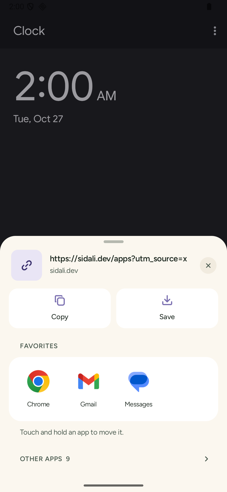
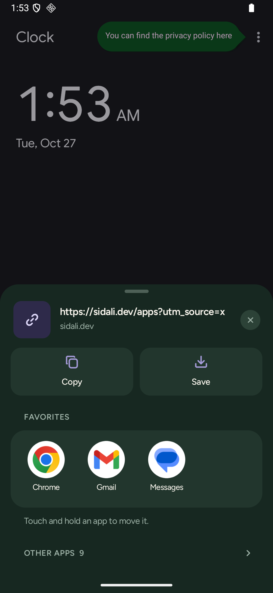
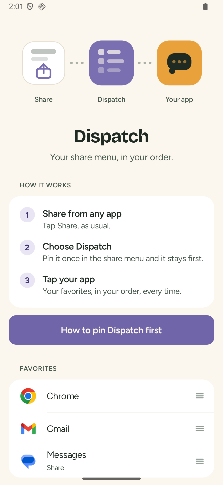

<p align="center">
  
  &nbsp; 
  &nbsp; 
</p>

# Dispatch

**Your share menu, in your order.**

The Android share menu shuffles its apps, shows the same app four times (Feed, Messages, Reels, Stories) and puts a row of people you did not ask for at the top. Android does not let any app replace it. So Dispatch does the next best thing: it is a share target you pin once at the top of the system menu, and it opens *your* list.

Share as usual, tap Dispatch, tap your app. Two taps, always in the same place.

## What it does

- **Your favorites, in your order.** Add any app that can receive what you share, down to the exact screen: keep "Instagram Messages", hide "Stories". Reorder by touch and hold, or with Move up and Move down (also available to screen readers).
- **Only what fits.** Sharing an image shows only the apps that accept images; your order stays the same.
- **Other apps** stay one tap away, sorted by name, each with a Pin button.
- **Copy** text or a link. Links are cleaned of tracking parameters first: `utm_*`, `fbclid`, `gclid`, `igshid`, `igsh`, `mc_*`, and `si` on YouTube and Spotify links.
- **Copy image** puts a shared image on the clipboard.
- **Save** writes what you shared into the folder you pick (no storage permission needed).
- **Remember last used** (off by default) shows the app you used last above your favorites.
- **Its own color.** Lavender, the same on the icon and in the app, on cream pages in light and pine night pages in dark. Every text passes WCAG AA contrast, computed for each pair of colors (see `Palette` in `Tokens.kt`).
- **About**: our principles, what's new, the date of the last security review, the signing certificate of the installed app (compare it with [SECURITY.md](SECURITY.md)), the privacy policy, and **What leaves your device** (nothing: no internet access).
- **Erase everything** (type ERASE to confirm) resets favorites and settings and deletes the private copies of copied images.
- **Themed icon**: a rounded paper plane that follows the system colors when themed icons are on, and **predictive back**: swipe back and the share sheet follows your finger before it closes.

## Principles

| | |
|---|---|
| No permission at all | Not even internet access. Check `aapt2 dump permissions` on the APK, or the permissions screen once installed. |
| No QUERY_ALL_PACKAGES | Dispatch only sees the apps that can receive a share, through `<queries>` for SEND intents. |
| Nothing is counted | No usage statistics, no history. The only things stored are your pinned and hidden apps, and one switch. |
| Nothing leaves the phone | No account, no analytics, no ads, no cloud backup, no device-to-device transfer of its data. |
| Reproducible builds | Two builds of the same commit produce byte-identical unsigned APKs. |

## Screenshots

Every main screen in light and dark, in [docs/screenshots](docs/screenshots): `main-*` is the home screen, `share-*` the share sheet, `pin-*` the guide to pin Dispatch, `about-*`, `permissions-*`, `leaves-*` and `erase-*` the About screen, Permissions, What leaves your device and the Erase everything confirmation, `icon.png` the launcher icon. The first version, styled after iOS, is kept in [docs/screenshots/before](docs/screenshots/before).

## Install

Android 11 or newer. Built and tested for GrapheneOS, works on any Android.

- **[Obtainium](https://github.com/ImranR98/Obtainium)** (recommended): add `https://github.com/sidalidev/dispatch`. Obtainium installs Dispatch from the GitHub releases and keeps it up to date.
- Or download the APK from the [latest release](https://github.com/sidalidev/dispatch/releases/latest) and check its SHA-256 against the `.sha256` file published next to it.

Either way, check the signing certificate against the one in [SECURITY.md](SECURITY.md) (`apksigner verify --print-certs`, or About > Signing certificate once installed).

Dispatch cannot update itself, by design: it has no internet access. Updates come through Obtainium, or by installing the new APK by hand.

Then pin it: open the share menu from any app, touch and hold Dispatch, tap **Pin**. The app's home screen explains it too, with a button that opens the share menu for you.

## How it works

1. `ShareActivity` receives `ACTION_SEND` and `ACTION_SEND_MULTIPLE` for any type.
2. `Targets.forShare` asks the package manager which activities accept the very intent that was shared, exactly like the system menu. Dispatch removes itself and your hidden targets (`Arrange` in `Order.kt`), then shows your pinned targets in your order and the rest by name.
3. Tapping a target starts it with a copy of the original intent (action, type, extras, ClipData) and `FLAG_GRANT_READ_URI_PERMISSION`, so the target can read shared files: Dispatch passes on the access it was given.
4. **Copy image** copies the image into private storage and puts a `content://` URI to that copy on the clipboard. `ClipProvider` is not exported: the app you paste into gets one-off read access through the clipboard grant, and nothing else. The last three copies are kept.

Read `Order.kt`, `Links.kt` and `Targets.kt` first.

## Limits of Android

- **No replacing the system menu.** Android has no setting for a third-party share sheet. Pinning Dispatch is the closest thing.
- **No direct-share contacts.** The row of people in the system menu comes from sharing shortcuts published by each app. Only the system chooser can read them (`ShortcutManager` and `LauncherApps` keep them to the default launcher and the system); a normal app cannot list them or open them. Dispatch shows apps and their share screens, not people.
- **Quick Share stays first on Google builds.** On phones with Google Play services, the system menu keeps Quick Share in front of pinned apps. Not an issue on GrapheneOS without it.
- **Some targets require a permission** Dispatch does not hold (rare, mostly system apps). They are left out instead of failing when tapped.

## Build

```bash
JAVA_HOME=/path/to/jdk-21 ./gradlew :app:testDebugUnitTest :app:lintDebug :app:assembleRelease -Punsigned
```

Release signing reads `~/.dispatch/keystore.properties` if present; otherwise the release APK is unsigned. To check reproducibility, build the same commit twice from two clones with `-Punsigned` and compare the SHA-256 of `app-release-unsigned.apk`.

`sharecheck/` is a tiny test app, never published: two share targets that log what they receive (and whether each shared file opens), plus a screen that reads the clipboard like a messaging app. It is how sharing and copying are checked end to end on an emulator.

## Contributing

See [CONTRIBUTING.md](CONTRIBUTING.md). Security issues: [SECURITY.md](SECURITY.md). Privacy: [PRIVACY.md](PRIVACY.md). Threat model: [docs/THREAT_MODEL.md](docs/THREAT_MODEL.md).

CI runs `.github/checks.sh` after the build: the merged release manifest may only ask for the permissions in `docs/permissions.txt` (none), the text has no long dashes and no personal paths, the latest review in `docs/security/` is less than 6 months old, and `CHANGELOG.md` has an entry for the current version.

## License

[Apache-2.0](LICENSE)

The embedded fonts keep their own license, the SIL Open Font License 1.1: see [ASSETS.md](ASSETS.md).
